

# MANUAL DE USUARIO

## MAGNUS SIG

### Sistema de Gestión de Inventario
### Seguridad y Salud en el Trabajo (SG-SST)

---

**Versión:** 1.0
**Fecha:** Octubre 2026
**Desarrollado por:** Equipo Magnus SIG

---

*Sistema web para la administración de equipos de protección personal (EPP), dotación laboral, control de inventarios y gestión de servicios de seguridad y salud en el trabajo.*

---

## TABLA DE CONTENIDO

1. [Introducción](#1-introducción)
2. [Requisitos del Sistema](#2-requisitos-del-sistema)
3. [Acceso al Sistema](#3-acceso-al-sistema)
   - 3.1 [Inicio de Sesión](#31-inicio-de-sesión)
   - 3.2 [Roles de Usuario](#32-roles-de-usuario)
4. [Navegación General](#4-navegación-general)
   - 4.1 [Estructura de la Interfaz](#41-estructura-de-la-interfaz)
   - 4.2 [Barra Lateral de Navegación](#42-barra-lateral-de-navegación)
   - 4.3 [Barra Superior](#43-barra-superior)
   - 4.4 [Menú Móvil](#44-menú-móvil)
5. [Dashboard - Panel Principal](#5-dashboard---panel-principal)
   - 5.1 [Dashboard del Administrador](#51-dashboard-del-administrador)
   - 5.2 [Dashboard del Vendedor](#52-dashboard-del-vendedor)
6. [Módulo de Inventario](#6-módulo-de-inventario)
   - 6.1 [Vista General del Inventario (Admin)](#61-vista-general-del-inventario-admin)
   - 6.2 [Vista del Inventario (Vendedor)](#62-vista-del-inventario-vendedor)
7. [Módulo de Productos](#7-módulo-de-productos)
   - 7.1 [Catálogo de Productos](#71-catálogo-de-productos)
   - 7.2 [Crear Nuevo Producto](#72-crear-nuevo-producto)
   - 7.3 [Ficha Técnica del Producto](#73-ficha-técnica-del-producto)
8. [Módulo de Categorías](#8-módulo-de-categorías)
   - 8.1 [Listado de Categorías](#81-listado-de-categorías)
   - 8.2 [Crear Nueva Categoría](#82-crear-nueva-categoría)
9. [Módulo de Movimientos](#9-módulo-de-movimientos)
   - 9.1 [Historial de Movimientos](#91-historial-de-movimientos)
10. [Módulo de Entradas (Compras)](#10-módulo-de-entradas-compras)
    - 10.1 [Listado de Entradas](#101-listado-de-entradas)
    - 10.2 [Registrar Nueva Entrada](#102-registrar-nueva-entrada)
    - 10.3 [Confirmar Recepción de Entrada](#103-confirmar-recepción-de-entrada)
11. [Módulo de Salidas (Despachos)](#11-módulo-de-salidas-despachos)
    - 11.1 [Listado de Salidas](#111-listado-de-salidas)
    - 11.2 [Registrar Nueva Salida](#112-registrar-nueva-salida)
    - 11.3 [Despachar una Salida](#113-despachar-una-salida)
12. [Módulo de Proveedores](#12-módulo-de-proveedores)
    - 12.1 [Directorio de Proveedores](#121-directorio-de-proveedores)
    - 12.2 [Registrar Nuevo Proveedor](#122-registrar-nuevo-proveedor)
13. [Módulo de Clientes](#13-módulo-de-clientes)
    - 13.1 [Directorio de Clientes](#131-directorio-de-clientes)
    - 13.2 [Registrar Nuevo Cliente](#132-registrar-nuevo-cliente)
14. [Módulo de Servicios SG-SST](#14-módulo-de-servicios-sg-sst)
15. [Módulo de Reportes](#15-módulo-de-reportes)
16. [Módulo de Configuración](#16-módulo-de-configuración)
17. [Panel de Administración de Django](#17-panel-de-administración-de-django)
18. [Preguntas Frecuentes](#18-preguntas-frecuentes)
19. [Glosario de Términos](#19-glosario-de-términos)
20. [Soporte Técnico](#20-soporte-técnico)

---

## 1. Introducción

**Magnus SIG** es un sistema web de gestión de inventarios diseñado específicamente para empresas que requieren administrar equipos de protección personal (EPP), dotación laboral y servicios de seguridad y salud en el trabajo (SG-SST).

### ¿Qué permite hacer el sistema?

- **Controlar existencias** de productos de seguridad y dotación en bodega con ubicación detallada.
- **Registrar entradas** (compras a proveedores) que incrementan automáticamente el inventario.
- **Registrar salidas** (despachos a clientes) que descuentan existencias con validación de stock disponible.
- **Mantener trazabilidad** completa de todas las operaciones con fecha, hora y responsable.
- **Gestionar contactos** de proveedores y clientes con información fiscal y comercial.
- **Administrar servicios SG-SST** (capacitación, inspecciones, medicina ocupacional, etc.).
- **Visualizar métricas** de rendimiento del inventario en un dashboard interactivo.
- **Generar reportes** exportables en formato CSV para análisis externo.
- **Configurar parámetros** del sistema como umbrales de stock mínimo y datos de la empresa.

### ¿Para quién está diseñado?

El sistema está orientado a dos tipos de usuarios:

| Rol | Descripción |
|-----|-------------|
| **Administrador** | Control total del sistema: gestiona productos, categorías, proveedores, entradas, reportes, configuración y panel administrativo. |
| **Vendedor** | Acceso operativo: consulta existencias, registra clientes y ejecuta despachos (salidas). |

---

## 2. Requisitos del Sistema

### Para usar el sistema (usuario final)

| Requisito | Especificación |
|-----------|---------------|
| **Navegador web** | Google Chrome (v100+), Microsoft Edge (v100+), Firefox (v100+) o Safari (v15+) |
| **Resolución mínima** | 320px de ancho (compatible con teléfonos móviles) |
| **Conexión** | Acceso a la red local donde se ejecuta el servidor |

### Para instalar el sistema (equipo técnico)

| Requisito | Especificación |
|-----------|---------------|
| **Sistema operativo** | Windows 10/11 |
| **Python** | Versión 3.12 o superior |
| **Node.js** | Versión 18 LTS o superior |
| **MySQL** | Versión 8.0 o superior |

> [!NOTE]
> La instalación técnica se describe en el archivo `README.md` del repositorio del proyecto. Este manual se centra en el uso del sistema por parte de los usuarios finales.

---

## 3. Acceso al Sistema

### 3.1 Inicio de Sesión

Para acceder al sistema, abra su navegador web y diríjase a la dirección proporcionada por el administrador (por ejemplo: `http://127.0.0.1:8000/login/`).

Se mostrará la pantalla de inicio de sesión:

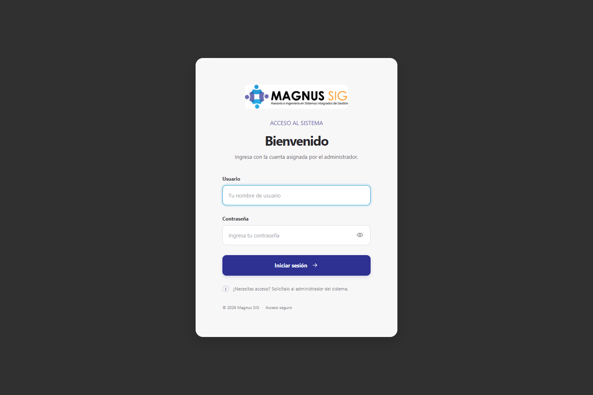

**Pasos para iniciar sesión:**

1. **Usuario:** Ingrese el nombre de usuario asignado por el administrador del sistema.
2. **Contraseña:** Ingrese la contraseña correspondiente a su cuenta.
3. **Mostrar contraseña:** Si lo desea, haga clic en el icono del ojo (👁) a la derecha del campo de contraseña para visualizar los caracteres ingresados.
4. **Iniciar sesión:** Haga clic en el botón azul **"Iniciar sesión"** o presione la tecla `Enter`.

> [!IMPORTANT]
> Si ve el mensaje *"Usuario o contraseña incorrectos"*, verifique que las credenciales sean correctas. Después de varios intentos fallidos, contacte al administrador del sistema.

> [!TIP]
> Si necesita una cuenta de acceso y no la tiene, comuníquese con el administrador. Solo él puede crear nuevos usuarios desde el panel de administración.

### 3.2 Roles de Usuario

El sistema maneja dos roles de acceso con diferentes permisos:

#### Rol Administrador
- Acceso completo a **todos los módulos** del sistema.
- Puede crear, editar y eliminar productos, categorías y contactos.
- Gestiona entradas (compras), salidas y movimientos.
- Accede a reportes con exportación CSV.
- Configura parámetros globales del sistema.
- Administra usuarios desde el panel `/admin/`.

#### Rol Vendedor
- Consulta el inventario y catálogo de productos.
- Registra nuevos clientes.
- Crea y gestiona salidas (despachos).
- **No puede** crear productos, categorías ni proveedores.
- **No puede** acceder a reportes, configuración ni al panel administrativo.

---

## 4. Navegación General

### 4.1 Estructura de la Interfaz

La interfaz de Magnus SIG se organiza en tres áreas principales:

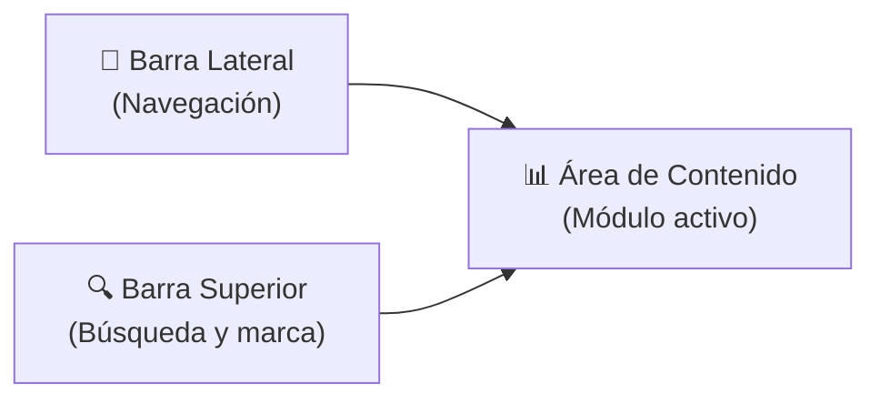

| Área | Ubicación | Función |
|------|-----------|---------|
| **Barra lateral** | Lado izquierdo | Menú de navegación principal con todos los módulos disponibles según su rol. |
| **Barra superior** | Parte superior | Logo de la empresa y barra de búsqueda global de productos. |
| **Área de contenido** | Centro-derecha | Muestra el módulo seleccionado: tablas, formularios, gráficos y KPIs. |

### 4.2 Barra Lateral de Navegación

La barra lateral oscura contiene todos los accesos directos a los módulos del sistema. Los elementos visibles dependen de su rol:

| Icono | Módulo | Administrador | Vendedor |
|:-----:|--------|:-------------:|:--------:|
| 📊 | Dashboard | ✅ | ✅ |
| 📦 | Inventario | ✅ | ✅ |
| 🧊 | Productos | ✅ | ✅ |
| 📑 | Categorías | ✅ | ✅ |
| 🔄 | Movimientos | ✅ | ✅ |
| 📥 | Entradas | ✅ | ❌ |
| 📤 | Salidas | ✅ | ✅ |
| 🏢 | Proveedores | ✅ | ❌ |
| 👥 | Clientes | ✅ | ✅ |
| ⚙️ | Servicios SG-SST | ✅ | ✅ |
| 📈 | Reportes | ✅ | ❌ |
| 🛠️ | Administración | ✅ | ❌ |

Al final de la barra lateral se encuentra el botón **"Cerrar sesión"** para salir del sistema de forma segura.

### 4.3 Barra Superior

La barra superior incluye:
- **Logo corporativo** de Magnus SIG a la izquierda.
- **Barra de búsqueda** global que permite localizar productos por nombre, código o categoría desde cualquier pantalla.
- **Indicador de estado** que muestra "Entorno local" confirmando la conexión activa.

### 4.4 Menú Móvil

En dispositivos móviles y tablets, el sistema se adapta automáticamente:
- La barra lateral se oculta y aparece un botón **hamburguesa** (☰) en la esquina superior izquierda.
- Al tocarlo, se despliega un menú lateral deslizante con todas las opciones de navegación.
- Se puede cerrar tocando el botón **✕**, tocando fuera del menú o pulsando la tecla `Escape`.

---

## 5. Dashboard - Panel Principal

El Dashboard es la pantalla principal del sistema. Ofrece una vista rápida del estado general del inventario.

### 5.1 Dashboard del Administrador

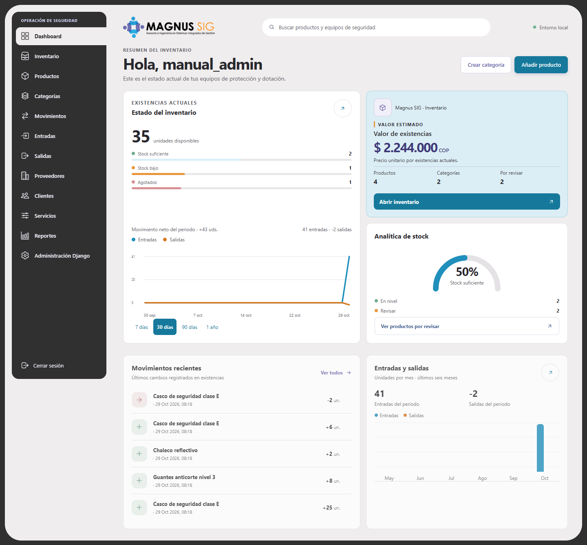

El Dashboard del Administrador presenta:

#### Tarjetas de Indicadores Clave (KPIs)
- **Valor total del inventario:** Muestra la suma monetaria de todas las existencias valoradas a precio de compra.
- **Total de productos registrados:** Cantidad de referencias diferentes en el sistema.
- **Productos con alerta de stock bajo:** Productos cuya existencia actual es igual o inferior al stock mínimo configurado.
- **Movimientos recientes:** Conteo de operaciones de entrada y salida en el período activo.

#### Gráfico de Tendencia del Inventario
- Línea de tendencia que muestra la evolución de las existencias durante los últimos 30 días.
- Diferencia entradas (color verde) y salidas (color rojo) con el saldo neto.
- Se actualiza automáticamente con cada movimiento registrado.

#### Panel de Actividad Reciente
- Lista cronológica de las últimas operaciones realizadas por todos los usuarios.
- Muestra tipo de movimiento, producto, cantidad, responsable y fecha.

#### Panel de Salud del Inventario
- Indicador visual (gauge) que refleja el porcentaje de productos dentro de rangos saludables de stock.
- Código de colores: verde (saludable), amarillo (atención), rojo (crítico).

### 5.2 Dashboard del Vendedor

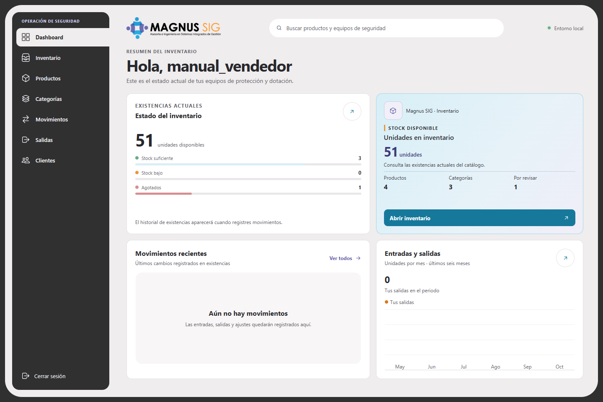

El Dashboard del Vendedor muestra la información relevante para sus funciones operativas:
- Existencias disponibles de los productos que puede despachar.
- Resumen de sus salidas realizadas.
- Productos con alerta de stock bajo para informar al administrador.

> [!NOTE]
> El Vendedor no ve los valores monetarios del inventario ni los indicadores de compra. Su Dashboard está enfocado en la operación diaria.

---

## 6. Módulo de Inventario

El módulo de Inventario es la vista operativa de las existencias físicas actuales en bodega.

### 6.1 Vista General del Inventario (Admin)

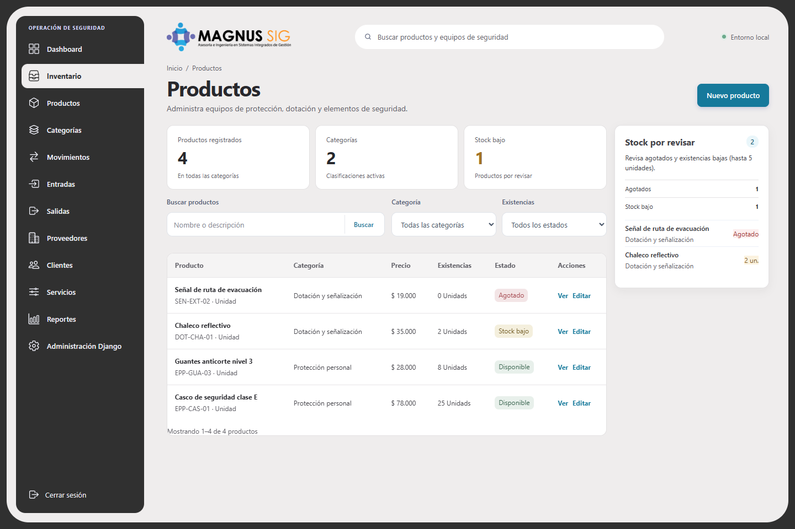

**Elementos de la pantalla:**

1. **Barra de estadísticas:**
   - Total de productos registrados.
   - Valor total del inventario.
   - Productos con stock bajo (alerta).

2. **Barra de búsqueda y filtros:**
   - **Buscar:** Permite localizar productos por nombre, código o descripción.
   - **Filtro por categoría:** Desplegable que filtra los productos por su familia.
   - **Filtro por estado de stock:** Muestra solo los productos con alerta, sin stock o todos.

3. **Tabla de existencias:**
   - **Código/SKU:** Identificador único del producto.
   - **Producto:** Nombre y descripción breve.
   - **Categoría:** Familia a la que pertenece.
   - **Existencias:** Cantidad actual en bodega.
   - **Estado:** Badge de color que indica el nivel de stock:
     - 🟢 **OK:** Stock saludable (por encima del mínimo).
     - 🟡 **Bajo:** Igual o inferior al stock mínimo configurado.
     - 🔴 **Agotado:** Sin existencias disponibles.

### 6.2 Vista del Inventario (Vendedor)

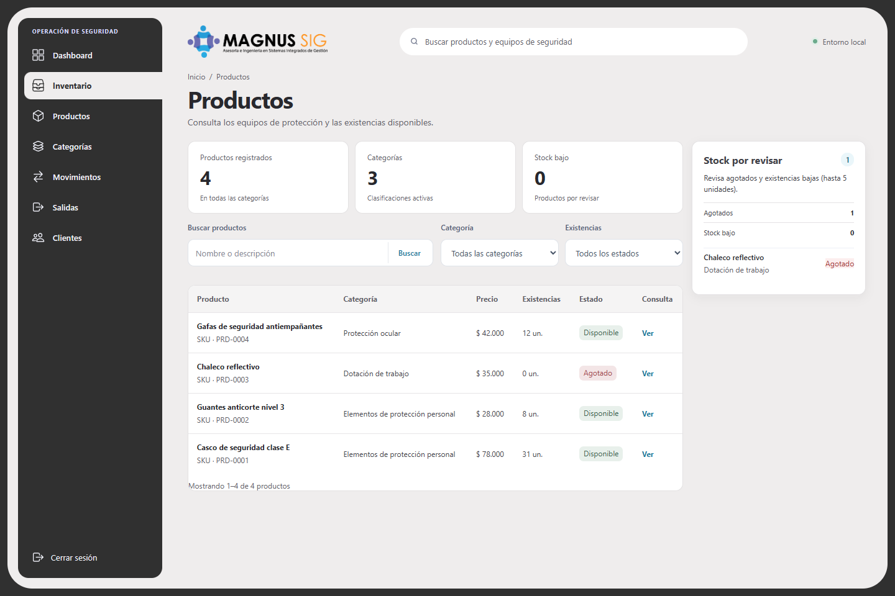

El vendedor ve la misma tabla de existencias pero con las siguientes diferencias:
- No se muestra el valor monetario del inventario.
- Los botones de creación y edición de productos no están disponibles.
- Puede buscar y filtrar productos para consultar disponibilidad antes de registrar una salida.

---

## 7. Módulo de Productos

### 7.1 Catálogo de Productos

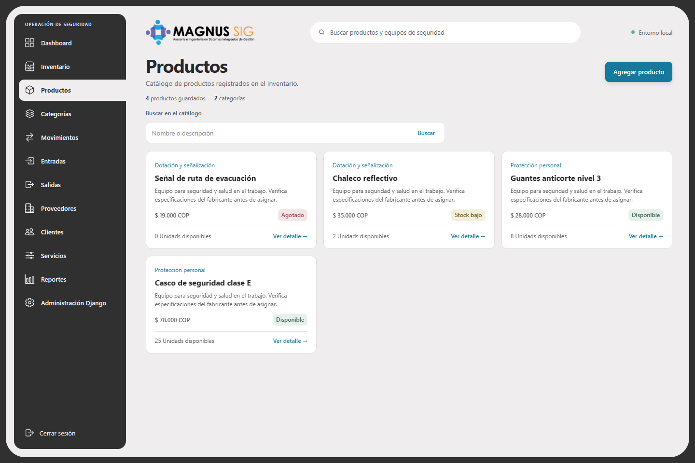

El catálogo presenta los productos en formato de tarjetas visuales con:
- Nombre del producto y código/SKU.
- Categoría a la que pertenece.
- Precio de venta y estado de existencias.
- Botón de acceso a la ficha técnica detallada.

**Funciones disponibles:**
- **Búsqueda en tiempo real:** Escriba en la barra de búsqueda y los resultados se filtran instantáneamente sin recargar la página (tecnología HTMX).
- **Filtro por categoría:** Seleccione una categoría del desplegable para ver solo los productos de esa familia.

### 7.2 Crear Nuevo Producto

*(Solo Administrador)*

**Paso 1:** Haga clic en el botón **"Nuevo producto"** desde el Inventario o el Catálogo.

Se abrirá el formulario de creación:

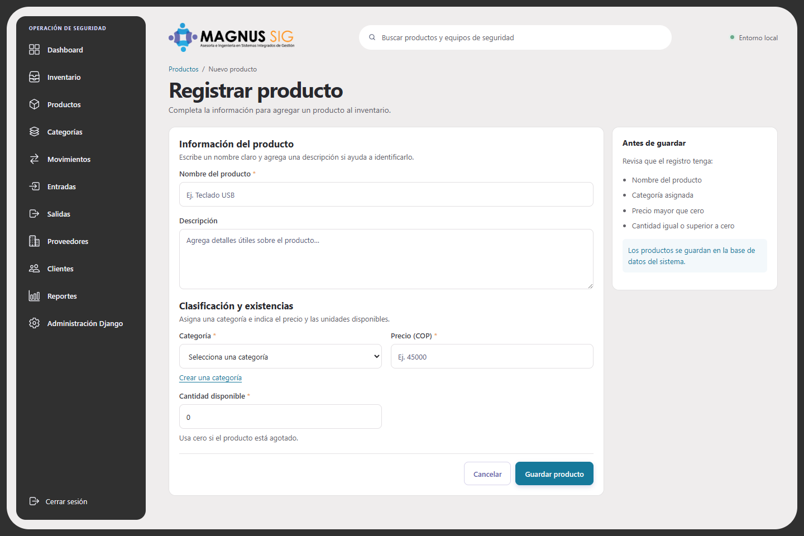

**Paso 2:** Complete los campos del formulario:

| Campo | Descripción | Obligatorio |
|-------|-------------|:-----------:|
| **Código / SKU** | Identificador único del producto (ej: `CAM-001`). | ✅ |
| **Nombre** | Nombre completo del producto. | ✅ |
| **Descripción** | Detalle técnico o características del producto. | ❌ |
| **Categoría** | Familia a la que pertenece (desplegable). | ✅ |
| **Proveedor** | Proveedor principal asociado (desplegable). | ❌ |
| **Precio de compra** | Costo de adquisición unitario en COP. | ✅ |
| **Precio de venta** | Precio de venta unitario en COP. | ✅ |
| **Unidad de medida** | Unidad, caja, metro, kilogramo, etc. | ✅ |
| **Stock mínimo** | Umbral de alerta para reabastecimiento. | ✅ |
| **Cantidad inicial** | Existencia inicial al registrar el producto. | ✅ |
| **Ubicación** | Posición física en bodega (ej: "Estante A3"). | ❌ |
| **Estado** | Activo o Inactivo. | ✅ |

**Paso 3:** Complete los datos y haga clic en **"Guardar producto"**.

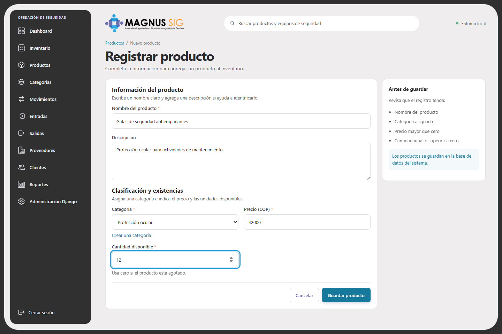

**Paso 4:** Verifique que el producto aparece en el inventario con la cantidad registrada.

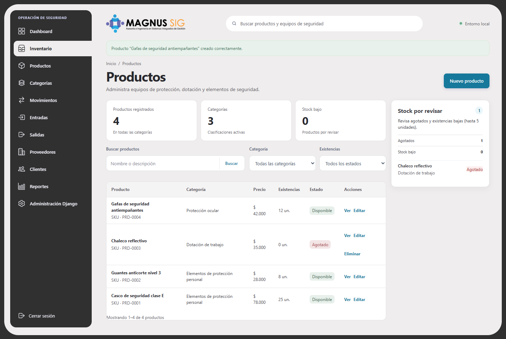

> [!TIP]
> El código/SKU debe ser único para cada producto. Se recomienda usar un formato consistente como `XXX-000` donde XXX es una abreviatura de la categoría.

### 7.3 Ficha Técnica del Producto

Al hacer clic en un producto, se abre su ficha técnica completa:

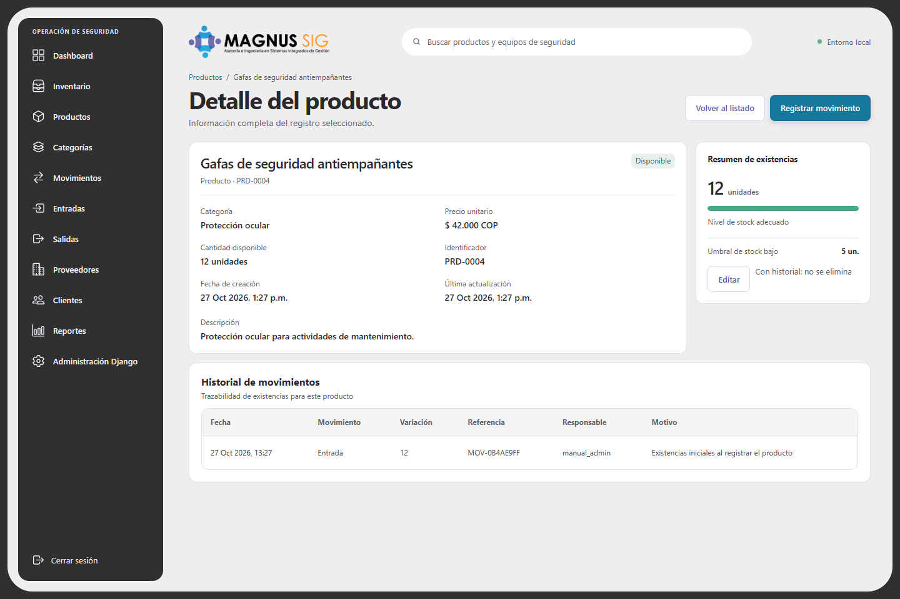

La ficha técnica incluye:
- **Información general:** Código, nombre, descripción, categoría y proveedor.
- **Información comercial:** Precio de compra, precio de venta y unidad de medida.
- **Estado del inventario:** Existencia actual, stock mínimo, ubicación física y estado de alerta.
- **Botones de acción:** Editar producto, registrar entrada, registrar salida y eliminar.

> [!WARNING]
> Los productos que tienen movimientos históricos asociados (entradas, salidas o ajustes) **no pueden ser eliminados** para preservar la integridad de los registros de trazabilidad.

---

## 8. Módulo de Categorías

Las categorías organizan los productos en familias lógicas para facilitar su búsqueda y gestión.

### 8.1 Listado de Categorías

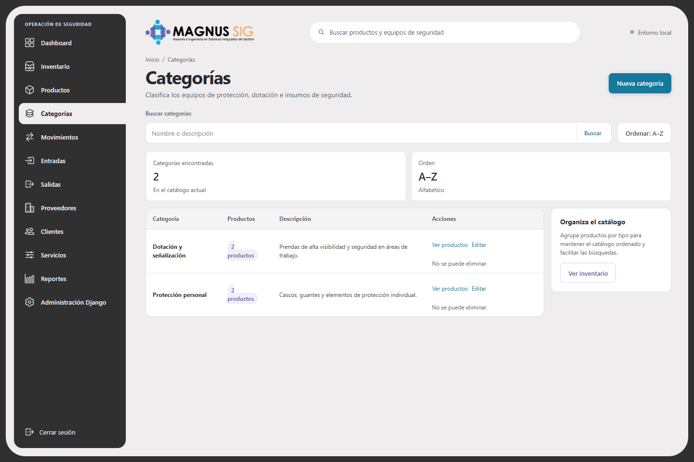

La pantalla muestra:
- Nombre de cada categoría con su descripción.
- Cantidad de productos asociados a cada categoría.
- Estado (activa/inactiva).
- Acciones de edición y eliminación (solo Administrador).

Las categorías iniciales del sistema son:

| Categoría | Descripción |
|-----------|-------------|
| Camillas | Camillas y equipos para transporte y atención de pacientes. |
| Botiquines | Botiquines y suministros de primeros auxilios. |
| Extintores | Extintores y equipos para control de incendios. |
| Elementos de protección personal | Elementos de protección personal (EPP). |
| Dotaciones | Dotaciones y prendas de trabajo. |
| Señalización | Señalización de seguridad y salud en el trabajo. |
| Insumos de emergencia | Insumos para atención de emergencias. |

### 8.2 Crear Nueva Categoría

*(Solo Administrador)*

**Paso 1:** En la pantalla de Categorías, haga clic en **"Nueva categoría"**.

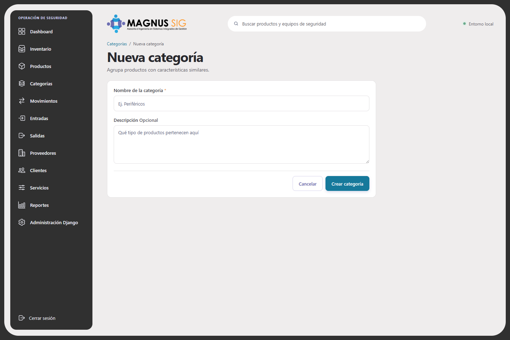

**Paso 2:** Complete los campos:

| Campo | Descripción | Obligatorio |
|-------|-------------|:-----------:|
| **Nombre** | Nombre único de la categoría. | ✅ |
| **Descripción** | Detalle de qué tipos de productos incluye. | ❌ |
| **Estado** | Activo o Inactivo. | ✅ |

**Paso 3:** Haga clic en **"Guardar categoría"**.

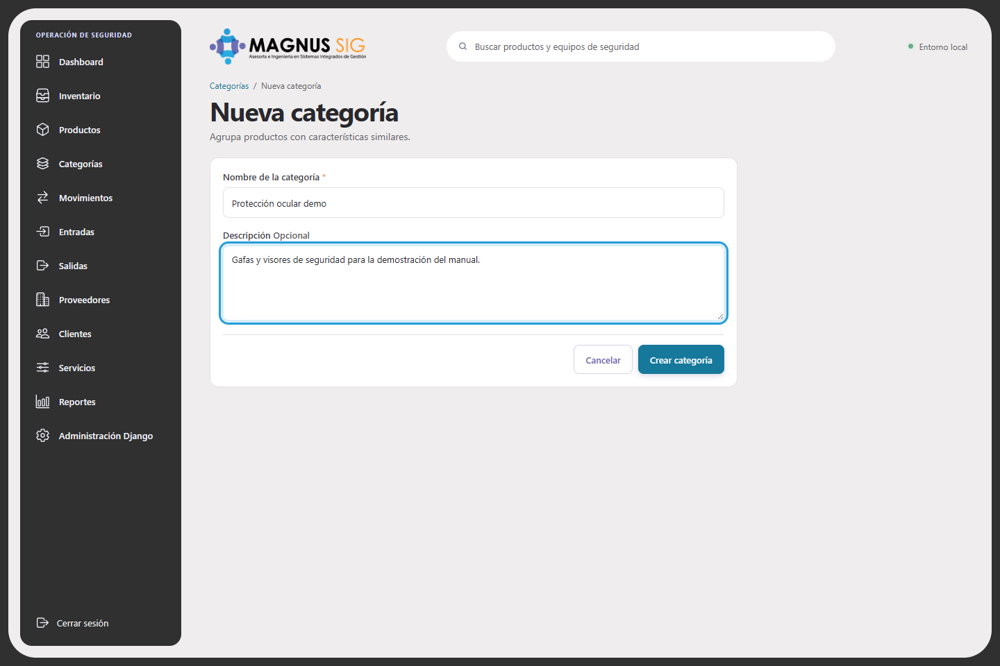

**Paso 4:** Verifique que la categoría aparece en el listado.

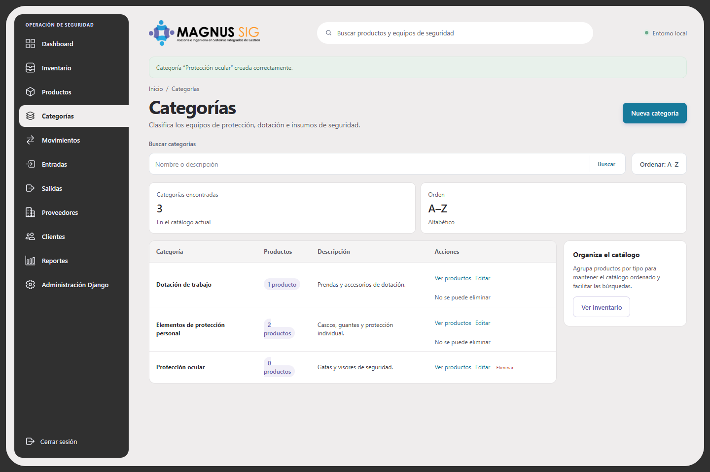

> [!IMPORTANT]
> No se permite crear dos categorías con el mismo nombre. El sistema validará la unicidad automáticamente.

---

## 9. Módulo de Movimientos

### 9.1 Historial de Movimientos

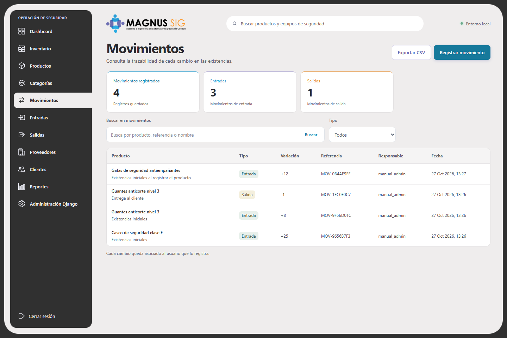

El módulo de Movimientos es el registro cronológico inmutable de todas las operaciones que afectan el stock del inventario.

**Cada movimiento registra:**

| Campo | Descripción |
|-------|-------------|
| **Producto** | Nombre y código del producto afectado. |
| **Tipo** | Entrada, Salida o Ajuste. |
| **Cantidad** | Unidades involucradas en la operación. |
| **Referencia** | Número de documento o factura asociada. |
| **Responsable** | Usuario que ejecutó la operación. |
| **Fecha** | Fecha y hora exactas del registro. |

**Filtros disponibles:**
- **Buscar:** Por nombre de producto, referencia o responsable.
- **Tipo:** Filtrar por entradas, salidas o ajustes.
- **Exportar CSV:** Descarga todos los movimientos en formato CSV (solo Administrador).

> [!NOTE]
> Los movimientos son **registros inmutables**. Una vez creados, no pueden ser editados ni eliminados. Esto garantiza la trazabilidad completa de las operaciones.

---

## 10. Módulo de Entradas (Compras)

*(Solo Administrador)*

Las entradas representan las recepciones de mercancía proveniente de proveedores. Al confirmar una entrada, el inventario se incrementa automáticamente.

### 10.1 Listado de Entradas

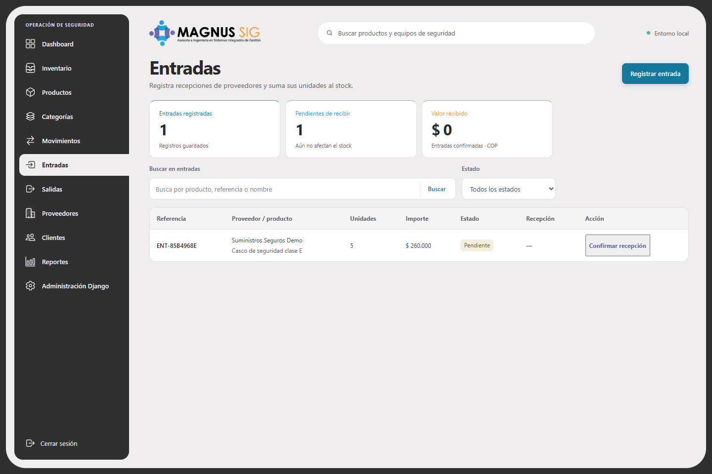

La pantalla muestra:
- KPIs: Total de entradas, borradores pendientes y valor total recibido.
- Tabla con todas las entradas registradas y su estado actual.

**Estados de una entrada:**

| Estado | Significado | Acción disponible |
|--------|-------------|-------------------|
| 🟡 **Borrador** | Entrada registrada pero no confirmada. El stock **no** ha sido afectado. | Confirmar recepción |
| 🟢 **Recibida** | Entrada confirmada. El stock se incrementó automáticamente. | Ninguna |
| 🔴 **Cancelada** | Entrada anulada. No afecta el stock. | Ninguna |

### 10.2 Registrar Nueva Entrada

**Paso 1:** Haga clic en **"Nueva entrada"** desde la pantalla de Entradas.

**Paso 2:** Complete el formulario:

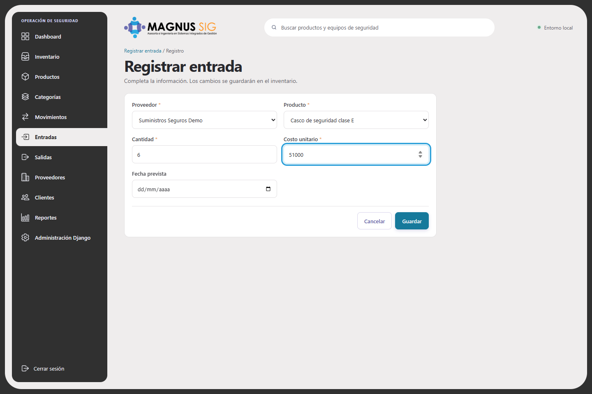

| Campo | Descripción | Obligatorio |
|-------|-------------|:-----------:|
| **Proveedor** | Seleccione el proveedor que envía la mercancía. | ✅ |
| **Producto** | Seleccione el producto que se va a recibir. | ✅ |
| **Cantidad** | Número de unidades recibidas. | ✅ |
| **Costo unitario** | Precio de compra por unidad. | ✅ |
| **Número de factura** | Referencia del documento del proveedor. | ❌ |
| **Observaciones** | Notas adicionales sobre la recepción. | ❌ |

**Paso 3:** Haga clic en **"Guardar entrada"**. La entrada quedará en estado **Borrador**.

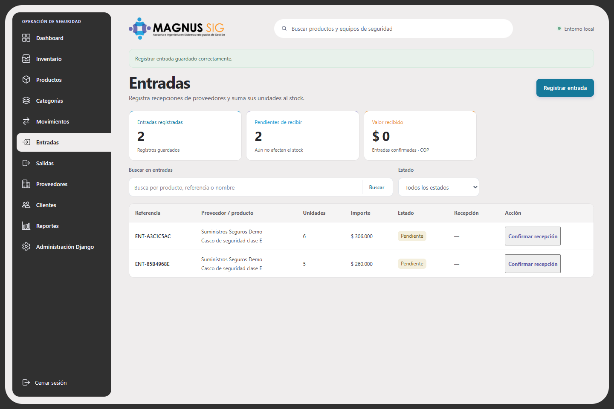

### 10.3 Confirmar Recepción de Entrada

**Paso 4:** En el listado de entradas, localice la entrada con estado **Borrador** y haga clic en el botón **"Confirmar recepción"**.

**Paso 5:** El sistema procesará la operación:
- Cambiará el estado a **Recibida** (badge verde).
- Incrementará automáticamente las existencias del producto en el inventario.
- Generará un movimiento de tipo "entrada" en el historial.

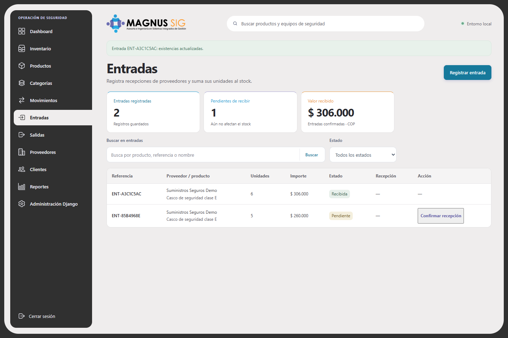

> [!CAUTION]
> La confirmación de recepción es una acción irreversible. Una vez confirmada, el stock se incrementa y el movimiento queda registrado permanentemente. Asegúrese de verificar la cantidad y el producto antes de confirmar.

---

## 11. Módulo de Salidas (Despachos)

Las salidas representan los despachos de mercancía hacia clientes o áreas internas. Al despachar una salida, el inventario se descuenta automáticamente.

### 11.1 Listado de Salidas

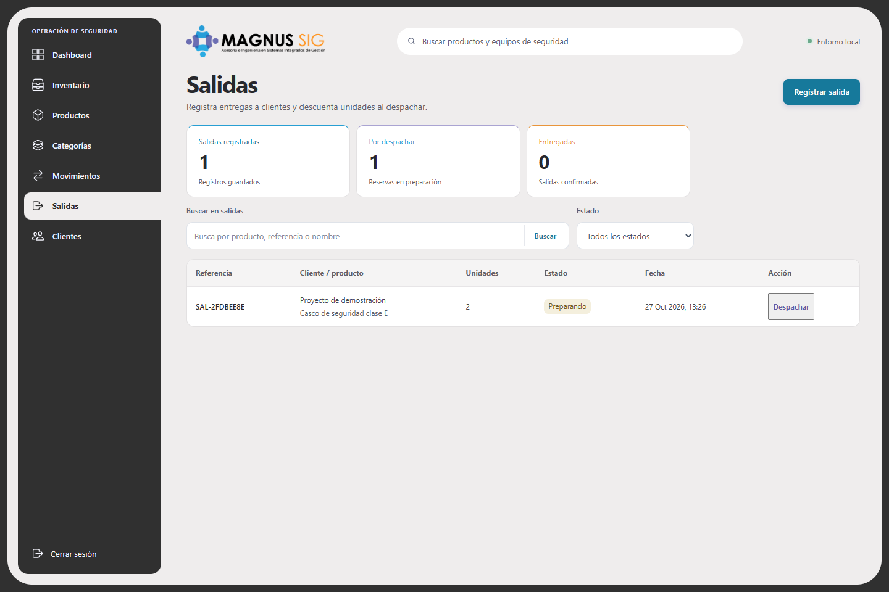

La pantalla muestra:
- KPIs: Total de salidas, órdenes por despachar y salidas confirmadas.
- Tabla con todas las salidas registradas.

**Estados de una salida:**

| Estado | Significado | Acción disponible |
|--------|-------------|-------------------|
| 🟡 **Borrador** | Salida registrada pero no despachada. El stock **no** ha sido afectado. | Despachar |
| 🟢 **Confirmada** | Salida despachada. El stock se descontó automáticamente. | Ninguna |
| 🔴 **Cancelada** | Salida anulada. No afecta el stock. | Ninguna |

### 11.2 Registrar Nueva Salida

**Paso 1:** Haga clic en **"Nueva salida"** desde la pantalla de Salidas.

**Paso 2:** Complete el formulario:

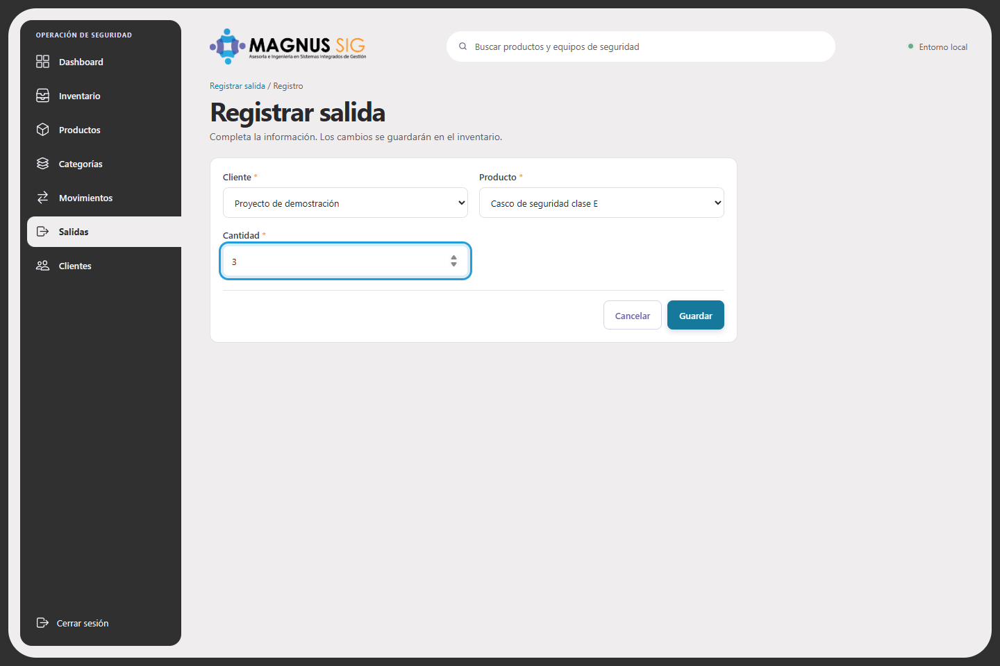

| Campo | Descripción | Obligatorio |
|-------|-------------|:-----------:|
| **Cliente** | Seleccione el cliente destino del despacho. | ✅ |
| **Producto** | Seleccione el producto a despachar. | ✅ |
| **Cantidad** | Número de unidades a enviar. | ✅ |
| **Precio unitario** | Precio de venta por unidad. | ✅ |
| **Observaciones** | Notas sobre el despacho. | ❌ |

**Paso 3:** Haga clic en **"Guardar salida"**. La salida quedará en estado **Borrador**.

> [!WARNING]
> El sistema valida que la cantidad solicitada no supere las existencias disponibles del producto. Si no hay suficiente stock, la operación será rechazada.

### 11.3 Despachar una Salida

**Paso 4:** En el listado de salidas, localice la orden con estado **Borrador** y haga clic en **"Despachar"**.

**Paso 5:** El sistema procesará la operación:
- Cambiará el estado a **Confirmada / Despachada** (badge verde).
- Descontará automáticamente las unidades del inventario.
- Generará un movimiento de tipo "salida" en el historial.

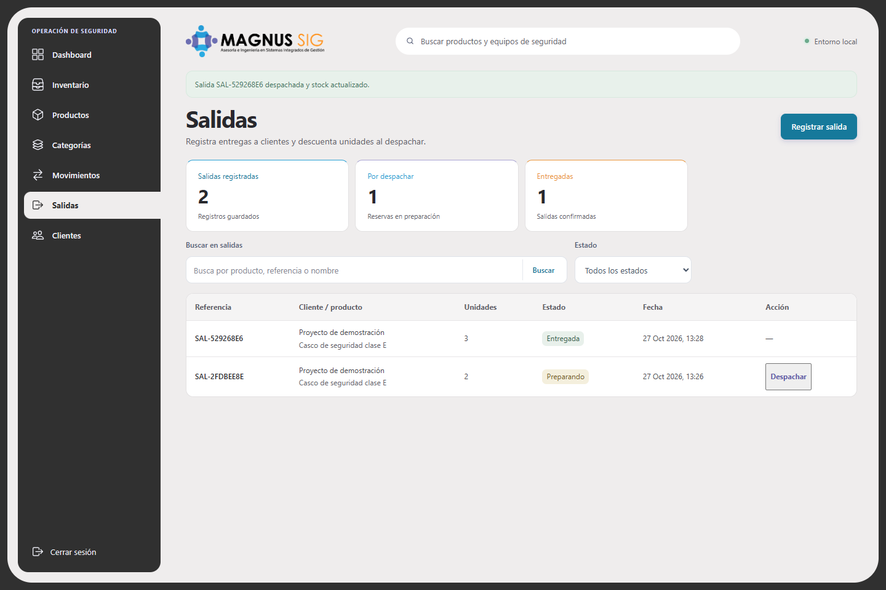

> [!CAUTION]
> El despacho es una acción irreversible. Una vez ejecutado, las existencias se descuentan permanentemente del inventario y el movimiento queda auditado. Verifique producto y cantidad antes de confirmar.

---

## 12. Módulo de Proveedores

*(Solo Administrador)*

### 12.1 Directorio de Proveedores

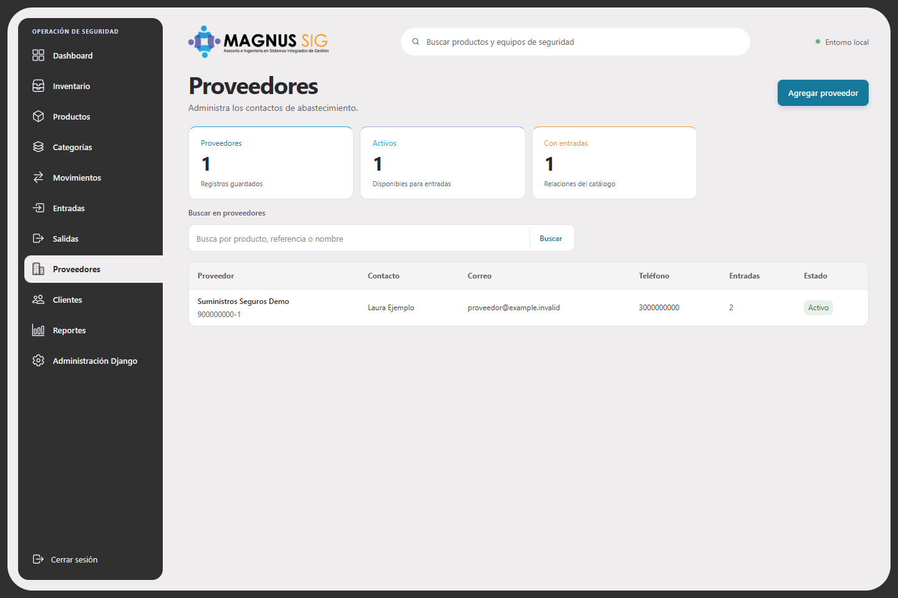

La pantalla lista todos los proveedores registrados con su información de contacto:
- NIT o documento de identificación.
- Razón social.
- Nombre del contacto comercial.
- Correo electrónico y teléfono.
- Estado (activo/inactivo).

### 12.2 Registrar Nuevo Proveedor

**Paso 1:** Haga clic en **"Nuevo proveedor"** desde la pantalla de Proveedores.

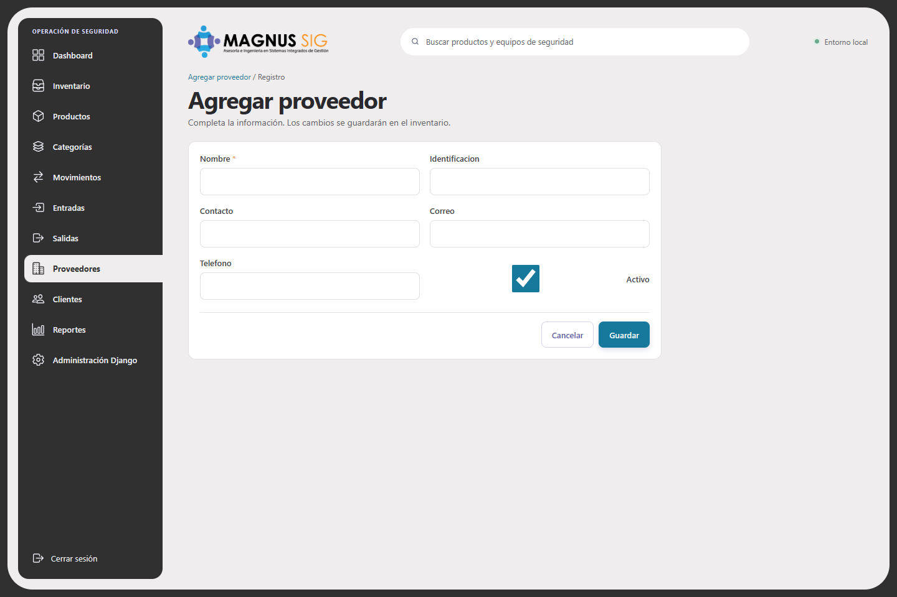

**Paso 2:** Complete los campos del formulario:

| Campo | Descripción | Obligatorio |
|-------|-------------|:-----------:|
| **Tipo de documento** | NIT, Cédula de ciudadanía, etc. | ✅ |
| **Número de documento** | Número del NIT o cédula (único). | ✅ |
| **Razón social** | Nombre legal de la empresa proveedora. | ✅ |
| **Nombre de contacto** | Persona de contacto en la empresa. | ❌ |
| **Teléfono** | Número de teléfono del contacto. | ❌ |
| **Correo** | Dirección de correo electrónico. | ❌ |
| **Dirección** | Dirección física del proveedor. | ❌ |
| **Ciudad** | Ciudad donde opera el proveedor. | ❌ |
| **Estado** | Activo o Inactivo. | ✅ |

**Paso 3:** Haga clic en **"Guardar proveedor"**.

> [!TIP]
> Los proveedores registrados estarán disponibles inmediatamente en el desplegable de "Proveedor" al crear productos y entradas.

---

## 13. Módulo de Clientes

### 13.1 Directorio de Clientes

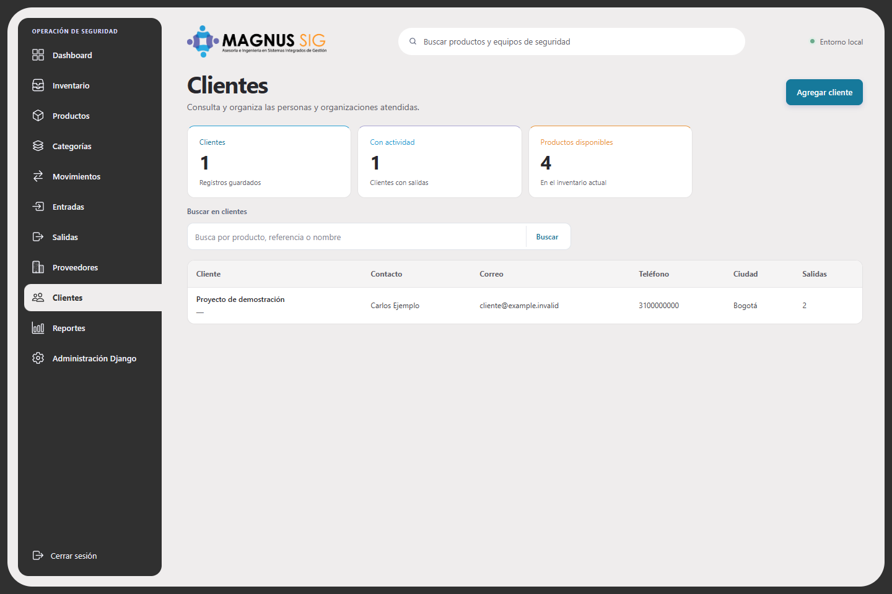

La pantalla lista todos los clientes registrados con:
- Tipo y número de documento.
- Razón social o nombre del cliente.
- Contacto, correo, teléfono y ciudad.

### 13.2 Registrar Nuevo Cliente

**Paso 1:** Haga clic en **"Nuevo cliente"**.

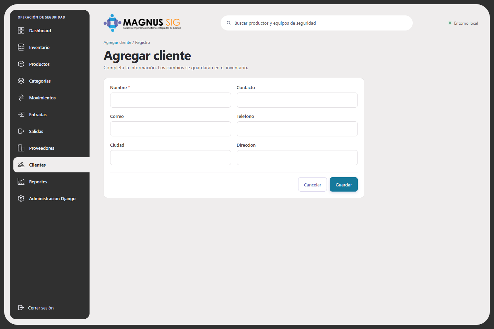

**Paso 2:** Complete los campos del formulario:

| Campo | Descripción | Obligatorio |
|-------|-------------|:-----------:|
| **Tipo de documento** | NIT, Cédula, etc. | ✅ |
| **Número de documento** | Identificación fiscal o personal (único). | ✅ |
| **Razón social** | Nombre legal del cliente o empresa. | ✅ |
| **Nombre de contacto** | Persona de contacto. | ❌ |
| **Teléfono** | Teléfono del contacto. | ❌ |
| **Correo** | Email del contacto. | ❌ |
| **Dirección** | Dirección de entrega o comercial. | ❌ |
| **Ciudad** | Ciudad del cliente. | ❌ |
| **Estado** | Activo o Inactivo. | ✅ |

**Paso 3:** Haga clic en **"Guardar cliente"**.

> [!NOTE]
> Tanto Administradores como Vendedores pueden registrar clientes. Los clientes registrados estarán disponibles en el desplegable de "Cliente" al crear salidas y servicios.

---

## 14. Módulo de Servicios SG-SST

El módulo de Servicios gestiona los servicios de consultoría, capacitación, inspecciones y medicina ocupacional que Magnus SIG ofrece a sus clientes como parte del Sistema de Gestión de Seguridad y Salud en el Trabajo.

**Tipos de servicios disponibles:**

| Código | Tipo de Servicio SG-SST |
|--------|------------------------|
| 1 | Consultoría en SG-SST |
| 2 | Capacitación y Formación |
| 3 | Exámenes Médicos Ocupacionales |
| 4 | Mediciones Ambientales |
| 5 | Planes de Emergencia |
| 6 | Investigación de Accidentes |
| 7 | Inspecciones de Seguridad |
| 8 | Matriz de Peligros y Riesgos |
| 9 | Programa de Vigilancia Epidemiológica |
| 10 | Comité Paritario (COPASST) |
| 11 | Plan de Trabajo Anual |
| 12 | Auditorías Internas SG-SST |
| 13 | Señalización Industrial |
| 14 | Dotación y EPP |
| 15 | Simulacros de Emergencia |
| 16 | Análisis de Puestos de Trabajo |
| 17 | Manejo de Sustancias Químicas |
| 18 | Trabajo en Alturas |
| 19 | Gestión del Cambio |

**Para registrar un nuevo servicio:**
1. Vaya al módulo **Servicios** desde la barra lateral.
2. Haga clic en **"Nuevo servicio"**.
3. Seleccione el cliente, el tipo de servicio, ingrese el valor estimado y las observaciones.
4. Haga clic en **"Guardar servicio"**.

**Estados de un servicio:**
- 🟡 **Pendiente:** Servicio solicitado, aún no iniciado.
- 🔵 **En proceso:** Servicio en ejecución.
- 🟢 **Finalizado:** Servicio completado exitosamente.
- 🔴 **Cancelado:** Servicio anulado.

---

## 15. Módulo de Reportes

*(Solo Administrador)*

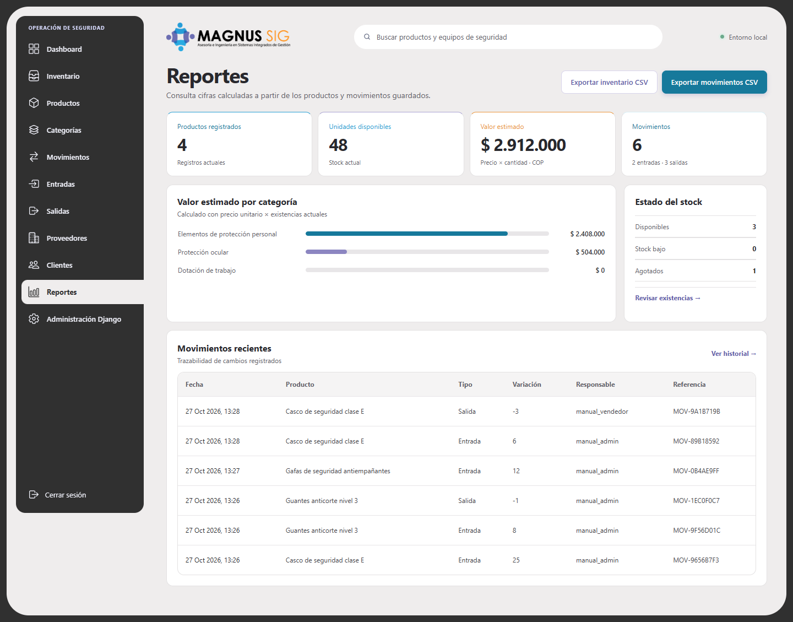

El módulo de Reportes presenta indicadores avanzados del desempeño del inventario:

**Indicadores disponibles:**
- **Valor total del inventario** desglosado por categoría.
- **Productos más movidos** (mayor número de entradas y salidas).
- **Productos con stock crítico** (por debajo del umbral mínimo).
- **Distribución de categorías** con gráfico de participación.
- **Tendencia de compras y ventas** durante el período seleccionado.

**Exportación de datos:**
- Haga clic en el botón **"Exportar CSV"** para descargar los datos del reporte en formato CSV.
- El archivo puede abrirse en Microsoft Excel, Google Sheets o cualquier herramienta de análisis de datos.

> [!TIP]
> Los reportes se calculan en tiempo real a partir de los registros almacenados en la base de datos. No se agregan datos ficticios ni proyecciones estimadas.

---

## 16. Módulo de Configuración

*(Solo Administrador)*

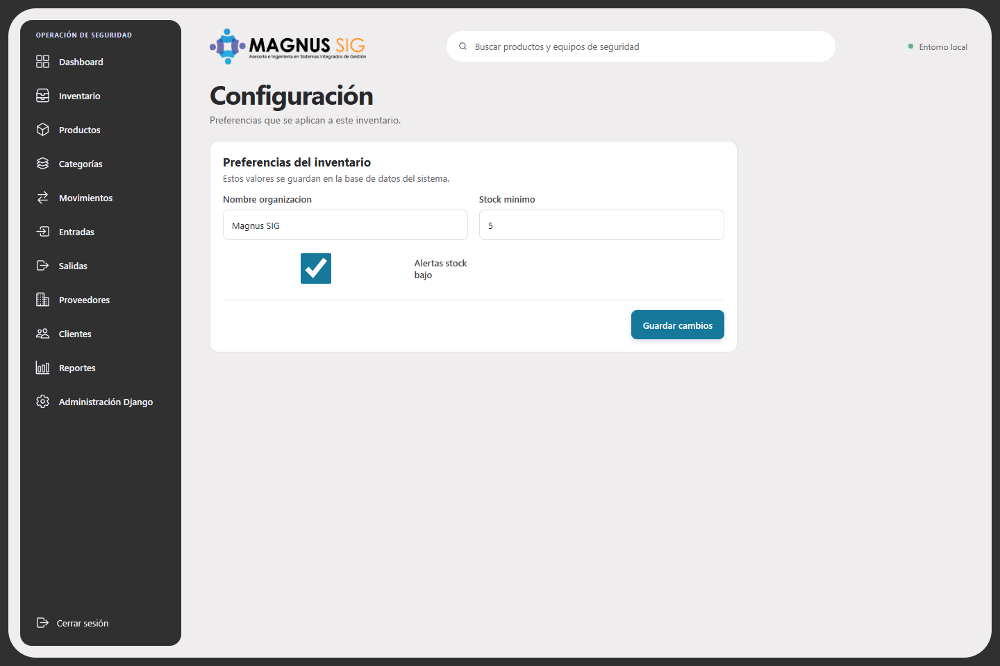

La pantalla de Configuración permite ajustar los parámetros globales del sistema:

| Parámetro | Descripción | Valor predeterminado |
|-----------|-------------|---------------------|
| **Nombre de la empresa** | Nombre que aparece en los encabezados y reportes. | Magnus SIG |
| **Moneda** | Símbolo monetario utilizado en precios y valores. | COP (\$) |
| **Stock mínimo global** | Umbral predeterminado de alerta para nuevos productos. | 5 unidades |

**Para modificar la configuración:**
1. Ajuste los valores deseados en los campos correspondientes.
2. Haga clic en **"Guardar configuración"**.
3. Los cambios se aplicarán inmediatamente en todo el sistema.

---

## 17. Panel de Administración de Django

*(Solo Administrador con acceso de staff)*

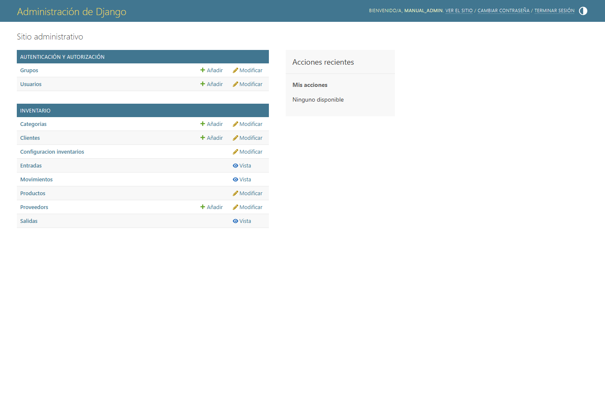

El panel de administración de Django (`/admin/`) proporciona acceso avanzado para:

- **Gestión de usuarios:** Crear, editar y desactivar cuentas de usuario.
- **Asignación de roles:** Agregar usuarios al grupo "Vendedor" o mantenerlos como administradores.
- **Auditoría de registros:** Revisar y editar directamente los registros de todas las tablas.
- **Gestión de grupos y permisos:** Configurar permisos granulares por módulo.

**Para crear un usuario vendedor:**
1. Acceda a `/admin/` e inicie sesión con su cuenta de administrador.
2. Vaya a **Usuarios** → **Agregar usuario**.
3. Ingrese el nombre de usuario y la contraseña.
4. En la sección **Grupos**, seleccione el grupo **Vendedor**.
5. **No** active la casilla "Es staff" (para que no pueda acceder al panel administrativo).
6. Guarde el usuario. El vendedor podrá iniciar sesión desde `/login/`.

> [!CAUTION]
> Solo los usuarios con la marca "Es superusuario" tienen acceso irrestricto al panel de administración. Nunca asigne este privilegio a cuentas operativas.

---

## 18. Preguntas Frecuentes

### ¿Cómo recupero mi contraseña?
Contacte al administrador del sistema. Solo él puede restablecer las contraseñas desde el panel de administración de Django (`/admin/`) o ejecutando el comando `changepassword` en la terminal del servidor.

### ¿Puedo registrar una salida si el producto tiene stock en cero?
No. El sistema valida automáticamente que haya existencias suficientes antes de permitir registrar una salida. Si el stock es insuficiente, recibirá un mensaje de error indicando la cantidad disponible.

### ¿Por qué no puedo eliminar un producto?
Los productos que tienen movimientos históricos asociados (entradas, salidas o ajustes) no pueden ser eliminados para preservar la trazabilidad. Puede cambiar su estado a "Inactivo" si ya no se comercializa.

### ¿Los datos se guardan automáticamente?
Sí. Cada operación que usted confirma (crear, editar, confirmar entrada, despachar salida) se guarda inmediatamente en la base de datos MySQL. No es necesario guardar manualmente.

### ¿Puedo usar el sistema desde mi celular?
Sí. Magnus SIG es completamente responsivo. En dispositivos móviles se activa automáticamente un menú hamburguesa (☰) que permite navegar por todos los módulos. Las tablas se desplazan horizontalmente para mostrar toda la información.

### ¿Qué significan los colores de los badges de estado?
- 🟢 **Verde (OK / Recibida / Despachada):** Estado positivo, operación completada satisfactoriamente.
- 🟡 **Amarillo (Bajo / Borrador / Pendiente):** Requiere atención o acción pendiente.
- 🔴 **Rojo (Agotado / Cancelada):** Estado crítico o anulado.

### ¿Puedo deshacer una entrada o salida confirmada?
No. Las confirmaciones de recepción (entradas) y despacho (salidas) son irreversibles. Si cometió un error, registre un movimiento de ajuste para corregir el stock y documente el motivo.

### ¿Cuántos usuarios pueden usar el sistema simultáneamente?
En el entorno de desarrollo local, el sistema soporta varios usuarios simultáneos sin problema. Para uso institucional concurrente, se recomienda desplegar en un servidor dedicado.

---

## 19. Glosario de Términos

| Término | Definición |
|---------|-----------|
| **SKU** | Stock Keeping Unit. Código único que identifica un producto en el inventario. |
| **EPP** | Equipos de Protección Personal. Elementos como cascos, guantes, gafas, etc. |
| **SG-SST** | Sistema de Gestión de Seguridad y Salud en el Trabajo. Marco normativo colombiano. |
| **Stock mínimo** | Cantidad mínima que debe existir en bodega antes de generar una alerta de reabastecimiento. |
| **Entrada** | Operación de recepción de mercancía que incrementa las existencias del inventario. |
| **Salida** | Operación de despacho de mercancía que descuenta existencias del inventario. |
| **Movimiento** | Registro atómico e inmutable de cualquier cambio en las existencias (entrada, salida o ajuste). |
| **Borrador** | Estado inicial de entradas y salidas antes de ser confirmadas. No afecta el stock. |
| **Trazabilidad** | Capacidad de rastrear el historial completo de cada operación con fecha, hora y responsable. |
| **Dashboard** | Panel de control visual que resume las métricas clave del inventario. |
| **KPI** | Key Performance Indicator. Indicador clave de rendimiento mostrado en las tarjetas del dashboard. |
| **COP** | Peso colombiano. Moneda predeterminada del sistema. |
| **NIT** | Número de Identificación Tributaria. Documento fiscal de empresas en Colombia. |
| **CSV** | Comma Separated Values. Formato de archivo para exportar datos tabulares. |
| **COPASST** | Comité Paritario de Seguridad y Salud en el Trabajo. |

---

## 20. Soporte Técnico

### Contacto interno
Para problemas de acceso, errores del sistema o solicitudes de nuevas funcionalidades, contacte al administrador del sistema.

### Información técnica de referencia
- **Tecnología:** Django 6.1, Python 3, MySQL 8.0
- **Repositorio:** [CRUD_MagnusSIG en GitHub](https://github.com/soykelian/CRUD_MagnusSIG)
- **Documentación técnica:** Archivo `README.md` en la raíz del proyecto.

### Diagnósticos rápidos

| Problema | Posible causa | Solución |
|----------|---------------|----------|
| No puedo iniciar sesión | Contraseña incorrecta o cuenta deshabilitada | Contacte al administrador para verificar credenciales |
| La página no carga | El servidor de desarrollo no está encendido | Ejecute `python manage.py runserver` en la terminal |
| No veo algunos módulos | Su rol no tiene permisos para esos módulos | Solicite al administrador la asignación del rol adecuado |
| Error de conexión a BD | MySQL no está activo en el equipo | Verifique que el servicio MySQL esté ejecutándose |
| El gráfico no se muestra | No hay movimientos registrados en el período | Registre al menos una entrada o salida para generar datos |

---

---

**Magnus SIG** — Sistema de Gestión de Inventario
*Asesoría e Ingeniería en Sistemas Integrados de Gestión*

© 2026 Magnus SIG. Todos los derechos reservados.

---

